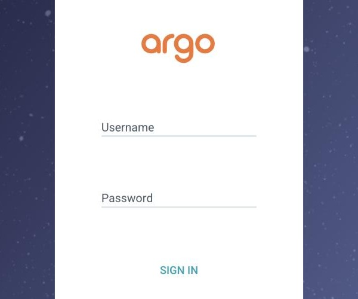
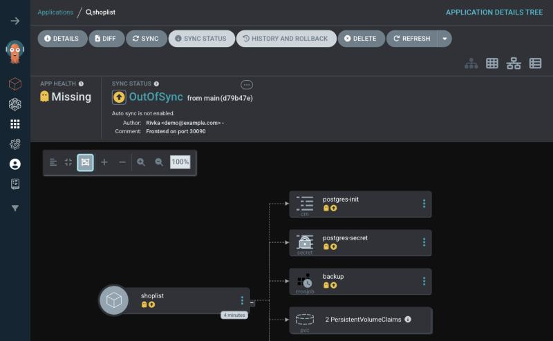
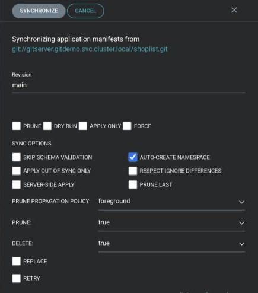
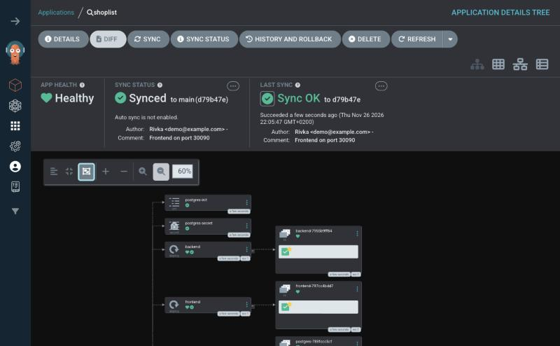
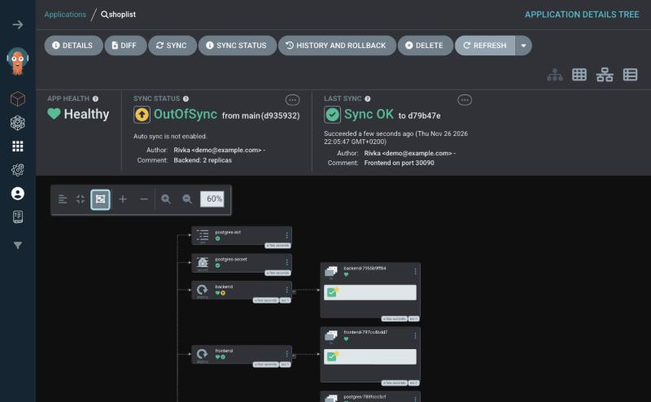
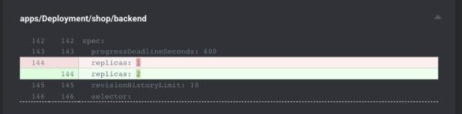
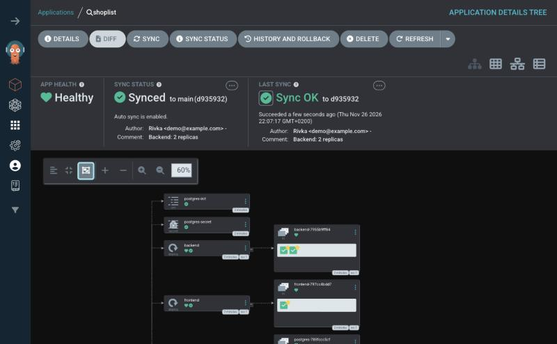
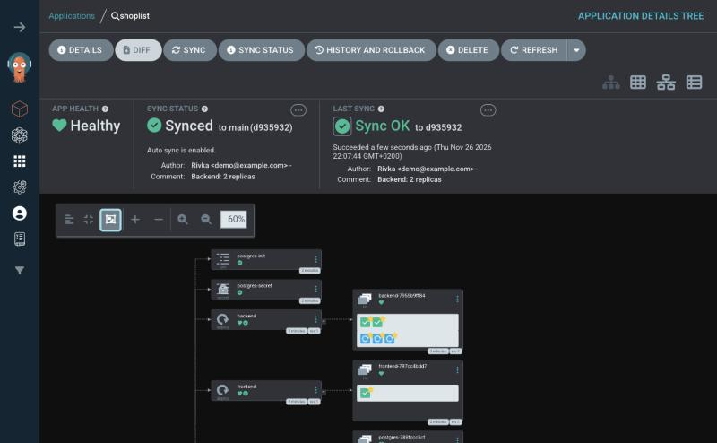
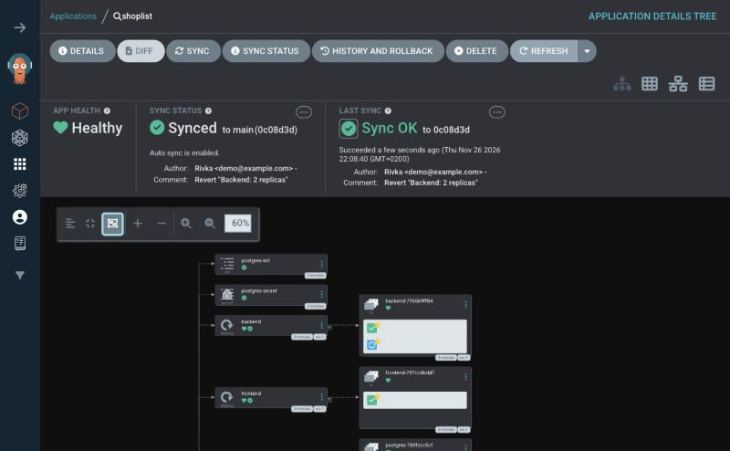
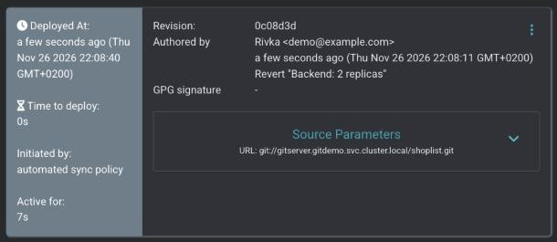

# שיעור 9 — GitOps: הריפו מנהל את ה-cluster
## מדריך לסטודנטית

בשיעור 8 בנינו pipeline שבודק, בונה ומעלה images ל-`ghcr.io`. אבל את הצעד האחרון, להתקין ב-cluster, עוד עשינו ביד. היום הצעד הזה נעלם: כלי בשם **Argo CD** רץ בתוך ה-cluster, מסתכל על הריפו, ומתקין כל שינוי לבד.

## מה יהיה בסוף השיעור

- הכלי Argo CD רץ ב-cluster שלכן, ב-namespace בשם `argocd`
- קובץ `argocd/application.yaml` בריפו: "כרטיס" שאומר ל-Argo CD איזה ריפו לקרוא, ולאן להתקין
- שינוי ב-`values.yaml`, commit ו-push, וה-cluster מתעדכן לבד
- שינוי ביד ב-cluster חוזר לבד למה שכתוב ב-Git
- חזרה לגרסה קודמת עם `git revert`
- ב-`ci.yml`: job חדש, `deploy`, שכותב את התגית החדשה ל-Git. מ-push של קוד, עד ה-cluster, בלי ידיים

**המשפט של היום:** מה שכתוב ב-Git, זה מה שרץ.

> **על צילומי המסך במדריך:** צולמו בחזרה, על המחשב של המורה. הריפו בחזרה היה שרת Git מקומי, לכן בצילומים כתוב `git://gitserver...` ולא `https://github.com/...`. אצלכן יופיע הריפו שלכן ב-GitHub. כל השאר זהה.

---

## לפני שמתחילות (בבית)

- [ ] שיעורי הבית של שיעור 8 עובדים: pipeline ירוק, ושלושה packages **ציבוריים** ב-`ghcr.io`
- [ ] בריפו שלכן יש `helm/shoplist/values-registry.yaml`, עם השם שלכן במקום `OWNER`
- [ ] הריפו שלכן ב-GitHub **ציבורי** (fork הוא ציבורי)
- [ ] זיכרון ל-Docker Desktop: Settings ← Resources ← Memory: **6GB לפחות**. Argo CD צורך זיכרון
- [ ] ב-Docker Desktop: Kubernetes running, ו-`kubectl config current-context` מחזיר `docker-desktop`
- [ ] להריץ `git pull` בתיקייה של הריפו

---

## חלק 1 — הצעד האחרון, עדיין ביד

### מה עשינו בסוף שיעור 8

אחרי כל pipeline ירוק, העתקנו את התגית מ-GitHub, והרצנו:

```bash
helm upgrade shop ./helm/shoplist -n shop \
    -f helm/shoplist/values-registry.yaml \
    --set backend.image.tag=a1b2c3d \
    --set stats.image.tag=a1b2c3d \
    --set frontend.image.tag=a1b2c3d
```

שלוש בעיות:

- **מי** הריצה, ומתי? אין לזה זכר.
- **מה** רץ עכשיו? התגית לא כתובה בשום קובץ ב-Git. היא הייתה רק בשורת הפקודה.
- **איפה** הפקודה? בהיסטוריה של הטרמינל של מישהי.

### סחף (drift)

שתיים בלילה, האתר איטי. מישהי מריצה:

```bash
kubectl scale deployment backend -n shop --replicas=5
```

זה עזר. ב-Git עדיין כתוב `replicas: 1`. שבוע אחרי, מישהי אחרת מריצה `helm upgrade` לשינוי אחר לגמרי, ו-backend חוזר לעותק אחד. באמצע היום.

לזה קוראים **drift**, סחף: ה-cluster התרחק ממה שכתוב ב-Git, ואף אחד לא יודע.

---

## חלק 2 — push או pull?

למה לא להוסיף ל-pipeline צעד של `helm upgrade`, וזהו?

| | push: ה-pipeline דוחף | pull: ה-cluster מושך |
|---|---|---|
| מי עושה את ההתקנה | ה-runner, במחשב של GitHub | סוכן שרץ בתוך ה-cluster |
| צריך להגיע ל-cluster מבחוץ | כן. כתובת, פורט פתוח, ומפתח | לא. הוא יוצא החוצה, אל Git |
| ה-cluster שלנו, במחשב בבית | לא נגיש מהאינטרנט | עובד |
| המפתח ל-cluster | שמור ב-GitHub, בתור Secret | לא יוצא מה-cluster |
| מגלה סחף | לא. רץ רק ב-push | כן. בודק כל כמה דקות |

ה-cluster ב-Docker Desktop רץ על המחשב שלכן. אין לו כתובת באינטרנט, ו-GitHub פשוט לא יכול להגיע אליו. יציאה החוצה, לעומת זאת, תמיד מותרת: כמו שהדפדפן שלכן יוצא לאינטרנט.

**הדרך pull** היא GitOps: ה-cluster שואל את Git מה צריך לרוץ.

---

## חלק 3 — GitOps

### ארבעה עקרונות

1. **מתואר בקובץ.** מה צריך לרוץ, ולא איך. ה-YAML וה-chart שכבר כתבנו.
2. **שמור ב-Git.** יש היסטוריה: מי שינתה, מתי, ולמה. ואפשר לחזור.
3. **נמשך אוטומטית.** סוכן בתוך ה-cluster מושך את השינוי. אף אחד לא מריץ פקודה.
4. **מתוקן כל הזמן.** הסוכן משווה כל כמה דקות, ומתקן סחף.

את 1 ו-2 כבר עשינו בשיעור 7. היום מוסיפות את 3 ו-4. הסוכן שלנו: **Argo CD**.

### האנלוגיה: מנהלת הסניף, ולוח ההזמנות

ממשיכות עם רשת הקונדיטוריות. במטבח תלוי **לוח הזמנות**: כל מה שהסניף צריך להציג, כתוב עליו. **מנהלת הסניף** לא אופה. כל כמה דקות היא מסתכלת על הלוח, מסתכלת על המדף, ואם יש הבדל, היא מביאה בדיוק מה שכתוב.

| בקונדיטוריה | ב-GitOps |
|---|---|
| לוח ההזמנות במטבח | הריפו ב-Git: `values.yaml` |
| המדף בסניף | ה-cluster: מה שרץ עכשיו |
| מנהלת הסניף, שמסתכלת על הלוח | Argo CD |
| כרטיס הזמנה קבועה: איזה לוח, איזה מדף | `Application` |
| המדף תואם ללוח | Synced |
| כתוב 3 עוגות, על המדף 2 | OutOfSync |
| מישהי הזיזה עוגה? המנהלת מחזירה | self-heal |
| נמחק מהלוח? יורד מהמדף | prune |
| רוצות עוגה חדשה? כותבות על הלוח | commit, ולא `kubectl` |

### הלולאה

בפנים, Argo CD עושה לולאה אחת, שוב ושוב:

1. **קוראת את Git.** אצלנו יש שם chart, אז היא מריצה `helm template`: ממלאת את החורים, ומקבלת YAML.
2. **קוראת את ה-cluster.** מה רץ עכשיו?
3. **משווה.** זהה? Synced. שונה? OutOfSync.
4. **מתקנת.** `kubectl apply` רק למה ששונה.

ושוב. את Git היא בודקת בערך כל 3 דקות, או מיד בכפתור **REFRESH**. שינויים ב-cluster היא רואה מיד, כי Kubernetes מודיע לה.

שימו לב: Argo CD **לא** מריץ `helm install`. הוא משתמש ב-Helm רק כדי לייצר YAML, ומתקין בעצמו. לכן `helm list` לא יראה אותו.

### שתי שאלות על כל Application

**שאלה 1, Sync: האם תואם ל-Git?**

| סטטוס | מה זה אומר |
|---|---|
| Synced | מה שרץ = מה שכתוב |
| OutOfSync | יש הבדל. ממתין, או מתקן |

**שאלה 2, Health: האם זה עובד?**

| סטטוס | מה זה אומר |
|---|---|
| Healthy | הכל רץ, ה-pods מוכנים |
| Progressing | עולה עכשיו. מחכים |
| Degraded | משהו נכשל. למשל `CrashLoopBackOff` |
| Missing | עוד לא קיים ב-cluster |

אפשר להיות **Synced וגם Degraded**: ה-cluster בדיוק כמו Git, אבל מה שכתוב ב-Git שבור. למשל, תגית של image שלא קיים.

---

## חלק 4 — להתקין את Argo CD

### מה מותקן

עוד אפליקציה, ב-namespace בשם `argocd`:

| ה-pod | מה הוא עושה | בסניף |
|---|---|---|
| `argocd-server` | האתר, ה-UI | דלפק הקבלה |
| `argocd-repo-server` | מושך מ-Git, ומריץ `helm template` | קוראת את הלוח |
| `argocd-application-controller` | משווה ומתקן. הלולאה | המנהלת |
| `argocd-redis` | זיכרון מהיר | פנקס |

### שלב 1 — התקנה עם Helm

```bash
helm repo add argo https://argoproj.github.io/argo-helm
helm repo update
helm install argocd argo/argo-cd -n argocd --create-namespace \
    --set configs.params."server\.insecure"=true \
    --set dex.enabled=false --set notifications.enabled=false
```

- ההגדרה `server.insecure`: בלי https, כי אנחנו על המחשב שלנו. בחברה: תמיד עם https.
- הרכיבים `dex` ו-`notifications`: כניסה עם חשבון Google, והודעות לסלאק. לא צריך, וזה חוסך זיכרון.

לחכות שכל ה-pods יהיו `Running`, בערך דקה:

```bash
kubectl get pods -n argocd
```

### שלב 2 — הסיסמה

הכלי Argo CD יוצר סיסמה אקראית למשתמשת `admin`, ושומר אותה ב-Secret. ערכים ב-Secret שמורים ב-base64 (שיעור 6):

```bash
kubectl -n argocd get secret argocd-initial-admin-secret \
    -o jsonpath="{.data.password}" | base64 -d; echo
```

### שלב 3 — להיכנס לאתר

בטרמינל **נפרד**, שנשאר פתוח:

```bash
kubectl port-forward svc/argocd-server -n argocd 8080:80
```

בדפדפן: `http://localhost:8080`. משתמשת `admin`, והסיסמה משלב 2.



בפנים: דף ריק. אין עדיין Applications.

---

## חלק 5 — Application: כרטיס ההזמנה הקבועה

### שלב 4 — argocd/application.yaml

בתיקייה הראשית של הריפו, תיקייה חדשה `argocd/`, ובה:

```yaml
# argocd/application.yaml - the standing order card
apiVersion: argoproj.io/v1alpha1
kind: Application
metadata:
  name: shoplist
  namespace: argocd            # Argo CD reads cards from here
spec:
  project: default
  source:                      # which board: repo, branch, folder
    repoURL: https://github.com/OWNER/devops-2027-shoplist.git
    targetRevision: main
    path: helm/shoplist
    helm:
      valueFiles: [values-registry.yaml]
  destination:                 # which shelf: cluster, namespace
    server: https://kubernetes.default.svc
    namespace: shop
  syncPolicy:
    syncOptions: [CreateNamespace=true]
```

- **במקום `OWNER`:** שם המשתמשת שלכן ב-GitHub.
- **השורה `kind: Application`:** סוג חדש, שהותקן יחד עם Argo CD. ה-namespace שלו `argocd`, כי משם Argo CD קורא כרטיסים.
- **החלק `source`:** הלוח. איזה ריפו, איזה branch, ואיזו תיקייה. יש בתיקייה `Chart.yaml`, אז Argo CD מבין לבד שזה Helm.
- **השורה `valueFiles`:** כמו `-f values-registry.yaml`. הנתיב הוא בתוך התיקייה של ה-chart.
- **החלק `destination`:** המדף. `kubernetes.default.svc` פירושו: ה-cluster שבו Argo CD רץ.
- **האפשרות `CreateNamespace=true`:** כמו `--create-namespace`.

ואיפה ה-tag של ה-image? **אין.** הוא ב-`values-registry.yaml`, בריפו. זה כל הרעיון.

### שלב 5 — לתת לו את הכרטיס

קודם, אם ShopList משיעור 8 עדיין מותקן ב-`shop`, למחוק אותו. אחרת הפורט 30080 תפוס:

```bash
helm uninstall shop -n shop
```

ואז:

```bash
git add argocd && git commit -m "Argo CD application" && git push
kubectl apply -f argocd/application.yaml
kubectl get applications -n argocd
```

```
NAME       SYNC STATUS   HEALTH STATUS
shoplist   OutOfSync     Missing
```

באתר: כרטיס חדש בשם `shoplist`. ללחוץ עליו:



- **הסטטוס OutOfSync:** ב-Git יש, ב-cluster אין.
- **הסטטוס Missing:** עוד לא נוצר כלום. רוח רפאים צהובה ליד כל משאב.
- **הכיתוב Auto sync is not enabled:** ברירת המחדל. Argo CD רק מראה את ההבדל, ומחכה שנלחץ.

### שלב 6 — Sync

ללחוץ **SYNC**, ואז **SYNCHRONIZE**:



אחרי חצי דקה: **Healthy** ו-**Synced**.



```bash
kubectl get pods -n shop
```

ו-`http://localhost:30080` עובד.

### לקרוא את העץ

| בעץ | מי יצר |
|---|---|
| `shoplist` | אנחנו: ה-Application |
| `deploy` backend | ה-chart, מ-Git |
| `rs` backend-7955... | ה-Deployment |
| `pod` | ה-ReplicaSet |

את ה-ReplicaSet ואת ה-pods אף אחד לא כתב: ה-Deployment יצר ReplicaSet, וה-ReplicaSet יצר pods. לחיצה על כל קופסה פותחת את ה-YAML, ה-events וה-logs. זה `kubectl describe` ו-`logs`, בעכבר.

---

## חלק 6 — לשנות רק דרך Git

### שלב 7 — שני עותקים של backend

בשיעור 6 היינו מריצות `kubectl scale`. בשיעור 7, `helm upgrade --set`. היום: Git.

ב-`helm/shoplist/values.yaml`:

```yaml
backend:
  replicas: 2          # was 1
```

```bash
git commit -am "Backend: 2 replicas"
git push
```

באתר: **REFRESH**. מיד **OutOfSync**, ולמעלה ה-commit החדש וההודעה שלו:



ללחוץ **DIFF**, ולסמן **Compact diff** ו-**Inline diff**:



עדיין Healthy: הכל עובד, פשוט לא מה שכתוב. וב-cluster עדיין pod אחד של backend.

### שלב 8 — סנכרון אוטומטי

ב-`argocd/application.yaml`, תחת `syncPolicy`:

```yaml
  syncPolicy:
    automated:          # sync by itself, no button
      prune: true       # removed from Git? delete it
      selfHeal: true    # changed by hand? put it back
    syncOptions: [CreateNamespace=true]
```

| שורה | בלי | עם |
|---|---|---|
| `automated` | OutOfSync, ומחכה ללחיצה | מסנכרן לבד |
| `prune` | נמחק מ-Git? נשאר ב-cluster | נמחק גם מה-cluster |
| `selfHeal` | שינוי ביד? OutOfSync, ונשאר | מחזיר למה שכתוב |

```bash
kubectl apply -f argocd/application.yaml
git commit -am "Argo CD: automated sync" && git push
```

כתוב `configured`, לא `created`: אותו כרטיס, עודכן. תוך שניות: **Auto sync is enabled**, ושני pods של backend.



### שלב 9 — self-heal: לשבור ביד

```bash
kubectl scale deployment backend -n shop --replicas=5
kubectl get deployment backend -n shop
```

```
NAME      READY   UP-TO-DATE   AVAILABLE
backend   2/2     2            2
```

ב-Git כתוב 2, אז 2. שלושת ה-pods החדשים נוצרים, ונמחקים תוך שניות:



**במטבח:** הלוח לא השתנה, אז המנהלת מחזירה את העוגה למקום.

**הלקח:** שינוי דחוף? commit דחוף. ואם באמת חייבים לשנות ביד, באמצע תקלה, קודם מכבות את `selfHeal`, ומתעדות.

### ניקיון, prune: נמחק מהלוח, יורד מהמדף

אם מכבות את הגיבוי ב-`values.yaml` (`backup.enabled: false`), ה-chart כבר לא מייצר את ה-CronJob. עם `prune`, הוא נמחק מה-cluster. בלי `prune`, הוא נשאר, ו-Argo CD מסמן אותו בסמל של פח.

**זהירות:** מחיקת ה-Application מוחקת את כל מה שהוא יצר. כל ShopList, כולל ה-PVC עם המידע של postgres.

### שלב 10 — חזרה אחורה: git revert

```bash
git log --oneline -3
git revert --no-edit HEAD
git push
```

הפקודה `git revert` יוצרת commit חדש, שמבטל את הקודם. Argo CD מסנכרן, ו-backend חוזר לעותק אחד:



**בכפתור HISTORY AND ROLLBACK:** כל sync, עם ה-commit, הכותבת, ומי הפעיל:



| | Helm, שיעור 7 | GitOps |
|---|---|---|
| איך חוזרים | `helm rollback` | `git revert`, ו-push |
| Git יודע? | לא | כן: commit חדש, עם הודעה |
| הכפתור ROLLBACK ב-Argo CD | — | עובד רק בלי `automated` |

למה לא הכפתור? כי אם ה-cluster יחזור אחורה, ו-Git עדיין אומר את הגרסה החדשה, self-heal יחזיר אותה תוך שניות. Git הוא האמת, אז חוזרות ב-Git.

---

## חלק 7 — המעגל המלא: CI בונה, Git זוכר, Argo CD מתקין

```
git push  ->  Actions: test, build  ->  ghcr.io: a1b2c3d  ->  commit "Deploy a1b2c3d"  ->  Argo CD: sync
```

- **ה-pipeline** לא נוגע ב-cluster. הוא רק בונה, ו**כותב ב-Git**.
- **הריפו ב-Git** זוכר כל גרסה שאי פעם רצה: commit בשם `Deploy`.
- **הכלי Argo CD** לא יודע שיש pipeline. הוא רק קורא את Git.

### שלב 11 — job של deploy

ב-`.github/workflows/ci.yml`, job שלישי, אחרי `build`:

```yaml
  deploy:
    needs: build                 # only after all 3 images are in ghcr.io
    runs-on: ubuntu-latest
    permissions:
      contents: write            # this job pushes a commit
    steps:
      - uses: actions/checkout@v6
      - name: Write the new tag to Git
        run: |
          TAG=${GITHUB_SHA::7}
          sed -i -E "s/^( +tag:).*/\1 \"$TAG\"/" \
            helm/shoplist/values-registry.yaml
          git config user.name "github-actions[bot]"
          git config user.email "github-actions@github.com"
          git commit -am "Deploy $TAG"
          git pull --rebase && git push
```

- **השורה `needs: build`:** רק אחרי ששלושת ה-images במחסן. אחרת Argo CD ינסה למשוך image שעוד לא קיים.
- **ההרשאה `contents: write`:** מותר ל-job הזה לעשות push. רק לו. ל-workflow כולו נשאר `contents: read`.
- **הפקודה `sed`:** מחליפה כל שורה שמתחילה ברווחים ו-`tag:`, בתגית החדשה. בתוך מירכאות, כי תגית של ספרות בלבד, כמו `1234567`, YAML היה קורא כמספר.
- **הפקודה `git pull --rebase`:** למקרה ש מישהי עשתה push בזמן שה-pipeline רץ.
- **ואין לולאה:** push שנעשה עם `GITHUB_TOKEN` לא מפעיל ריצה חדשה של ה-workflow.

אחרי push של קוד: בלשונית Actions שלושה שלבים, test, build ו-deploy. ב-`git log` יש commit שלא אתן עשיתן:

```bash
git pull
git log --oneline -2
```

```
e4f1a2b Deploy 7c3d9e1
7c3d9e1 Change the title
```

**חשוב:** מעכשיו, לפני כל עבודה, `git pull`. ה-pipeline עושה commits לריפו שלכן.

---

## חלק 8 — אותו pipeline ב-GitLab CI

הרבה חברות בארץ עובדות עם GitLab. אותו מתכון, מטבח אחר:

```yaml
# .gitlab-ci.yml - the same pipeline, in GitLab
stages: [test, build, deploy]

test:
  stage: test
  image: python:3.11
  script:
    - python -m py_compile app/backend/*.py

build:
  stage: build
  image: docker:27
  services: [docker:27-dind]
  parallel:
    matrix:
      - SERVICE: [backend, stats, frontend]
  script:
    - echo "$CI_REGISTRY_PASSWORD" | docker login $CI_REGISTRY
        -u "$CI_REGISTRY_USER" --password-stdin
    - IMAGE="$CI_REGISTRY_IMAGE/$SERVICE:$CI_COMMIT_SHORT_SHA"
    - docker build -t "$IMAGE" "app/$SERVICE"
    - docker push "$IMAGE"
```

| GitHub Actions | GitLab CI | מה זה |
|---|---|---|
| `.github/workflows/ci.yml` | `.gitlab-ci.yml` | המתכון |
| `runs-on: ubuntu-latest` | `image: python:3.11` | איפה רץ |
| `needs: test` | `stages: [test, build]` | הסדר |
| `strategy: matrix` | `parallel: matrix` | כמה עותקים |
| `uses: actions/checkout` | אוטומטי | להביא את הקוד |
| `ghcr.io`, `GITHUB_TOKEN` | `$CI_REGISTRY`, `$CI_JOB_TOKEN` | המחסן, וההרשאה |
| `${GITHUB_SHA::7}` | `$CI_COMMIT_SHORT_SHA` (8 תווים) | התגית |
| Settings → Secrets | Settings → CI/CD → Variables | סודות |
| push עם `GITHUB_TOKEN`: בלי ריצה | push עם token: כן ריצה. `-o ci.skip` | לולאה ב-deploy |

- **השורה `stages`:** כל ה-jobs באותו שלב רצים יחד. השלב הבא מתחיל רק אם כולם הצליחו.
- **השורה `image`:** כל job רץ בתוך container. אין `setup-python`: בוחרות image שיש בו Python.
- **השירות `docker:dind`:** Docker בתוך Docker, כדי לבנות images בתוך container.

### ול-Argo CD? לא אכפת

ה-CI בונה ומעלה למחסן. Git שומר. ה-CD קורא את Git ומסנכרן. שלוש קופסאות, שמדברות רק דרך Git. אם הריפו עובר ל-GitLab, משנים ב-Application שורה אחת:

```yaml
    repoURL: https://gitlab.com/OWNER/devops-2027-shoplist.git
```

---

## חלק 9 — מילון

| מילה | מה זה |
|---|---|
| GitOps | Git הוא האמת. ה-cluster מושך |
| drift | סחף: שינוי ביד, שלא ב-Git |
| push מול pull | נכנסים ל-cluster מבחוץ, או שה-cluster יוצא אל Git |
| `Application` | כרטיס: איזה ריפו, לאיזה namespace |
| Synced / OutOfSync | תואם ל-Git, או לא |
| Healthy / Progressing / Degraded / Missing | עובד, עולה, נכשל, לא קיים |
| REFRESH | לבדוק את Git עכשיו, בלי לחכות |
| SYNC | להביא את מה שכתוב ב-Git |
| `automated` | לסנכרן בלי כפתור |
| `selfHeal` | להחזיר שינוי ביד |
| `prune` | למחוק מה שנמחק מ-Git |
| `git revert` | החזרה אחורה ב-GitOps |
| `contents: write` | מותר ל-job לעשות push לריפו |
| `.gitlab-ci.yml` | ה-pipeline ב-GitLab |

---

## חלק 10 — ובעולם האמיתי?

- **שני ריפואים:** ריפו לקוד, וריפו נפרד להגדרות של כל ה-clusters. ה-pipeline כותב את התגית לריפו ההגדרות.
- **סביבות:** אותו chart, `values-staging.yaml` ו-`values-prod.yaml`, ו-Application לכל סביבה.
- **אישור ל-production:** השינוי עובר כ-Pull Request לריפו ההגדרות, ואדם מאשר.
- **אפליקציה של אפליקציות (app of apps):** Application אחד שמייצר את כל השאר, כשיש עשרות שירותים.
- **עוד כלים:** Flux, עם אותו רעיון בדיוק. Argo CD Image Updater, שמחפש בעצמו תגיות חדשות במחסן.
- **הרשאות:** כניסה עם החשבון של החברה, וכל צוות רואה רק את ה-Applications שלו.

---

## תקלות נפוצות

| מה רואות | מה עושים |
|---|---|
| pods של `argocd` ב-`Pending` או `OOMKilled` | חסר זיכרון. Docker Desktop: 6GB לפחות |
| `repository not found` | ריפו פרטי, או טעות ב-`repoURL` |
| `ComparisonError` על `values-registry.yaml` | הקובץ לא נדחף ל-Git, או לא בתיקייה של ה-chart |
| Synced, אבל `ImagePullBackOff` | התגית לא קיימת ב-ghcr, או ה-package פרטי |
| `provided port is already allocated` | 30080 תפוס. `helm uninstall shop -n shop` |
| שיניתי ב-Git, ולא קורה כלום | REFRESH. ובאמת עשיתן push? `git log origin/main -1` |
| deploy נכשל: `Permission denied` ב-push | חסר `contents: write` ב-job |
| `! [rejected] ... (fetch first)` ב-`git push` שלכן | ה-pipeline עשה commit. `git pull --rebase`, ואז push |
| שיניתי ביד, וזה חוזר | זה לא באג: `selfHeal`. משנות ב-Git |
| הכניסה לאתר נכשלת אחרי הפעלה מחדש | ה-port-forward נסגר. להריץ שוב |

---

## שאלות לראיון עבודה, עם תשובות

**1. מה זה GitOps? ומה ההבדל בין push ל-pull?**
בגישת GitOps, מה שרץ ב-cluster מתואר בקבצים ב-Git, וסוכן בתוך ה-cluster מושך ומסנכרן אותם כל הזמן. ב-push, ה-pipeline מתחבר מבחוץ ל-cluster ומתקין, ולכן צריך גישה ומפתח. ב-pull, הסוכן בתוך ה-cluster יוצא אל Git, המפתח לא יוצא מה-cluster, וגם סחף מתגלה ומתוקן.

**2. מה ההבדל בין Sync status ל-Health status?**
הסטטוס Sync: האם מה שרץ זהה למה שכתוב ב-Git. הסטטוס Health: האם מה שרץ עובד. הם בלתי תלויים: Synced ו-Degraded פירושו ש-Git מדויק, אבל מה שכתוב בו שבור.

**3. מישהי הריצה `kubectl scale`, ואחרי דקה זה חזר. למה?**
זה ה-selfHeal של Argo CD: הוא רואה שה-cluster שונה מ-Git, ומחזיר למה שכתוב. את השינוי עושים ב-Git, ב-commit. ואם חייבים ביד באמצע תקלה, מכבים קודם את selfHeal.

**4. איך חוזרים לגרסה קודמת, כש-Argo CD מנהל את ה-cluster?**
עם `git revert` ל-commit הבעייתי, ו-push. Argo CD מסנכרן. לא `helm rollback`, ולא הכפתור ב-Argo CD כשהסנכרון אוטומטי: Git הוא האמת, ו-selfHeal היה מחזיר את הגרסה מ-Git.

**5. איך ה-pipeline "מתקין", בלי גישה ל-cluster?**
הוא לא מתקין. הוא בונה images, ואז כותב את התגית החדשה בקובץ values ב-Git, ועושה commit ו-push. Argo CD רואה את ה-commit ומסנכרן.

**6. מה ההבדל בין GitHub Actions ל-GitLab CI?**
אותו רעיון, תחביר אחר. ב-GitLab: קובץ אחד `.gitlab-ci.yml`, סדר לפי `stages`, כל job רץ בתוך container לפי `image`, הקוד מגיע לבד, ומשתנים כמו `CI_COMMIT_SHORT_SHA`. ובשני המקרים, ה-CD יכול להיות אותו Argo CD.
